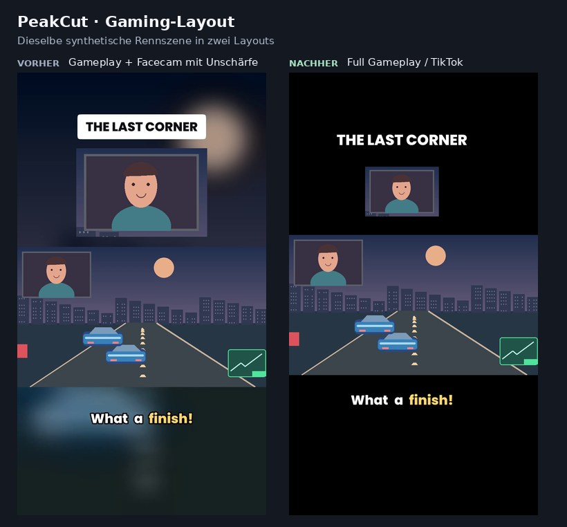

# Full Gameplay / TikTok



**Full Gameplay / TikTok** ist im Clip-Editor verfügbar und der Standard für erkannte Gaming-Videos mit automatischer Layoutwahl sowie für die Gaming-Watchlist. Unter **Layout** kann man weiterhin **Gameplay + facecam (blurred fill)**, die beiden anderen unscharfen Varianten und den mittigen Zuschnitt wählen. Die alten Videodateien werden nur neu gerendert, wenn jemand ausdrücklich **Save and re-make clip** auswählt. Alte Watchlist-Einträge mit dem bisherigen Gameplay-Standard verwenden für neue Clips das neue Layout. Bewusst gewählte Layouts sind weiterhin verfügbar und lassen sich im Creator-Setup speichern.

## Bildaufbau

- Das Originalbild bleibt vollständig in der 1080 × 1920 großen Ausgabe. Eine 1920 × 1080-Quelle belegt darin 1080 × 608 Pixel. Kleine Quellen behalten ihre Bildgröße mit zusätzlichen schwarzen Seitenflächen. PeakCut skaliert das Spielbild bei Bedarf einmal mit Lanczos und encodiert die Ausgabe einmal mit der bestehenden FFmpeg-Konfiguration.
- Der weiße Titel steht in der oberen schwarzen Fläche. Er verwendet dieselbe Schrift wie die Untertitel, höchstens zwei Zeilen und bleibt bis zu drei Sekunden sichtbar. Ein sicherer beschreibender Clip-Titel kann den Titel ergänzen, wenn kein eigener Hook vorliegt. Die Regeln für unbelegte Sprecherzitate gelten weiter.
- Eine erkannte Facecam erhält eine eigene Fläche oberhalb des Spiels. Eine bereits in die Quelle eingebrannte Kamera bleibt zusätzlich im vollständigen Originalbild sichtbar. Untertitel stehen unter dem Spiel. Die Text- und Kameraflächen nehmen Rücksicht auf die rechte Aktionsleiste und den unteren Bereich der TikTok-Oberfläche. Die eingeblendeten Bedienelemente können sich je nach Gerät und App-Version unterscheiden.
- Die Qualitätskontrolle betrachtet die ersten drei tatsächlich decodierten Frames im gerenderten Gameplay-Fenster. Sie ignoriert die schwarzen Randflächen und schließt die bekannte eingebrannte Facecam beim Helligkeitstest aus. Damit können heller Titel oder Facecam einen schwarzen Spielstart nicht verdecken. Die vorhandenen Prüfungen für Ton, Laufzeit, Bewegung, Sprecherzuordnung und Buffer-Entwürfe gelten weiter.

## Vergleich und Verifikation

Der Vergleich rendert dieselbe synthetische Szene mit den beiden vorhandenen Renderer-Pfaden. Ein TikTok-Referenzbild war im Workspace nicht verfügbar. Die Gestaltung folgt der schriftlich beschriebenen Vorlage. Die Beispieldatei zeigt keine veröffentlichte Aufnahme.

```bash
python tests/test_full_gameplay.py
CHROMIUM_PATH=/usr/bin/chromium node tests/test_layout_editor.cjs
python tests/run.py
```

Der Layout-Test prüft unter anderem echte FFmpeg-Pixel an beiden Spielbildrändern, die schwarzen Flächen, die Facecam-Zone, den Titel, die Untertitel und schwarze native Startframes. Der Browser-Test prüft die Auswahl und das Absenden der Einstellung im emulierten iPhone-Viewport.

Ein Offline-Durchlauf mit zwei zugewiesenen CPUs, einem Modell- und einem FFmpeg-Thread sowie 2,75 GiB virtuellem Adressraum pro Prozess verwendete eine synthetische 1080p60-Quelle von 66 Sekunden. Er erzeugte einen 59,3 Sekunden langen Clip in 1080 × 1920. Der Renderabschnitt benötigte rund 25 Sekunden. PeakCut erreichte rund 1,32 GiB Prozess-RSS. Die Qualitätsprüfung hielt den reinen Lautstärkefund erwartungsgemäß zurück. Der Lauf prüft das Ressourcenverhalten im Entwicklungscontainer. Hetzner Shared-CPU, aggregierter Container-RAM und die echte TikTok-Oberfläche bleiben davon unberührt.
